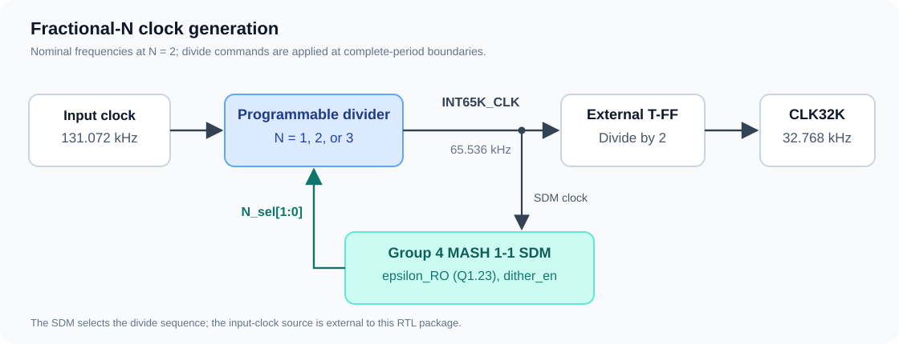

# Fractional-N Clock Divider

A Verilog/SystemVerilog implementation of a programmable clock divider with **divide-by-1, divide-by-2, and divide-by-3** modes, a MASH 1-1 sigma-delta modulator integration, and an external toggle flip-flop. The nominal clock path converts a **131.072 kHz** input into **65.536 kHz**, then **32.768 kHz**.

Developed as a Group 2 academic project at the Department of Electrical Engineering, Sharif University of Technology. The repository includes the final RTL, self-checking testbenches, Cadence simulation and synthesis scripts, archived results, and the [final project report in Persian](docs/Final_Report_N_Divider.pdf).

## Highlights

- Three integer divide modes selected through a two-bit command.
- Fractional average division through a sequence of integer divide commands.
- Commands applied at complete output-period boundaries.
- Dual-edge register implementation with an XOR output, replacing the earlier clock-mux architecture.
- Active-low asynchronous reset.
- Standalone divider and integrated sigma-delta verification.
- Post-synthesis netlists, SDF files, area reports, and timing reports.

## Architecture



The core module, `fractional_n_divider`, produces `INT65K_CLK`. The wrapper `frac_div_system` adds an external T flip-flop that toggles on every rising edge of `INT65K_CLK`. The integration top, `frac_div_g4_top`, connects the supplied Group 4 `sdm_mash11` block to the divider.

In this integration, the SDM is clocked by `INT65K_CLK`. A command generated on one output edge is consumed at the next complete divider-period boundary. `epsilon_RO` is a signed, 24-bit Q1.23 control input; `dither_en` enables the SDM's LFSR-based dither.

## Divider operation

| `N_sel` | Divide ratio | `INT65K_CLK` period | Steady-state waveform |
| --- | ---: | --- | --- |
| `00` | 1 | `T_RO` | Half a cycle high, half a cycle low |
| `01` | 2 | `2 * T_RO` | One cycle high, one cycle low |
| `10` | 3 | `3 * T_RO` | One cycle high, two cycles low |
| `11` | 2 | `2 * T_RO` | Safe default: divide-by-2 |

`T_RO` is the input-clock period. With a nominal input of 131.072 kHz, divide-by-2 gives 65.536 kHz at `INT65K_CLK` and 32.768 kHz at `CLK32K`. These signal names identify the nominal operating point; their frequencies change with the divide sequence.

For a command sequence applied once per output period:

$$
N_{\mathrm{avg}} = \frac{1}{M}\sum_{k=1}^{M} N_k,
\qquad
f_{\mathrm{INT,avg}} = \frac{f_{\mathrm{RO}}}{N_{\mathrm{avg}}},
\qquad
f_{\mathrm{CLK32K,avg}} = \frac{f_{\mathrm{RO}}}{2N_{\mathrm{avg}}}.
$$

The integrated SDM targets an average ratio of `2 * (1 + epsilon_RO)`, limited to the available range of 1 through 3. For example, nine divide-by-2 periods followed by one divide-by-3 period produce an average divide ratio of 2.1.

The final clock has a 50% duty cycle at the steady nominal divide-by-2 setting. With changing divide commands, consecutive high and low widths can differ; the T flip-flop still halves the long-term rising-edge rate.

### Core interface

| Port | Direction | Width | Purpose |
| --- | --- | ---: | --- |
| `clk` | Input | 1 | Input clock, nominally 131.072 kHz |
| `rst_n` | Input | 1 | Asynchronous, active-low reset |
| `N_sel` | Input | 2 | Divide command, encoded as above |
| `INT65K_CLK` | Output | 1 | Divided clock |

`frac_div_system` additionally exposes `CLK32K`. `frac_div_g4_top` takes `epsilon_RO` and `dither_en`, and exposes the SDM-generated `N_sel` along with both clocks.

## Repository contents

| Location | Contents |
| --- | --- |
| [`rtl/`](rtl/) | Divider, external T flip-flop, system wrapper, and integration top |
| [`tb/`](tb/) | Directed divider tests and SDM integration tests |
| [`external/g4_sdm/`](external/g4_sdm/) | Supplied Group 4 SDM RTL, standalone testbench, netlist, and SDF |
| [`scripts/`](scripts/) | Xcelium regressions, Genus synthesis, coverage, and evidence summary |
| [`constraints/`](constraints/) | Divider SDC constraints |
| [`netlist/`](netlist/) | Archived synthesized divider netlist, SDF, and generated constraints |
| [`sim/rtl/`](sim/rtl/) | Archived RTL simulation logs |
| [`sim/gate/`](sim/gate/) | Archived gate-level logs, synthesis reports, and timing reports |
| [`coverage/`](coverage/) | Archived coverage-run logs |
| [`docs/`](docs/) | Final report and reproduction notes |
| [`figures/`](figures/) | Architecture illustration |

The main entry points are [`rtl/fractional_n_divider.v`](rtl/fractional_n_divider.v), [`tb/tb_frac_div_system.v`](tb/tb_frac_div_system.v), and [`tb/tb_system_g4.sv`](tb/tb_system_g4.sv).

## Tools and requirements

The archived flow used Cadence Xcelium **22.03-s001** and Genus **21.10-p002_1**, with a TSMC 180 nm typical library. RTL simulation needs Xcelium and Bash. Synthesis and gate-level simulation additionally need the matching technology libraries, which are not included.

Run the commands below from the repository root in Linux or another suitable Bash environment with the required EDA tools configured. See [reproduction notes](docs/REPRODUCIBILITY.md) for library paths, archived results, and known limitations.

```bash
git clone https://github.com/Mohammadmsh84/Ftactional-Ndivider.git
cd Ftactional-Ndivider
```

### Run RTL regressions

```bash
# Standalone Group 4 SDM, divider, and integrated system
bash scripts/run_week4_pre_synth.sh
```

Individual runs:

```bash
bash scripts/sim_xcelium_rtl.sh
bash scripts/sim_xcelium_sdm.sh
bash scripts/sim_xcelium_g4_standalone.sh
```

Longer SDM runs are available through `FULL_SIM=1`:

```bash
FULL_SIM=1 bash scripts/sim_xcelium_sdm.sh
FULL_SIM=1 bash scripts/sim_xcelium_g4_standalone.sh
```

### Synthesize the divider

First update the library search path and library name in [`scripts/synth_genus.tcl`](scripts/synth_genus.tcl) for your environment. Then run:

```bash
mkdir -p sim/gate
set -o pipefail
genus -f scripts/synth_genus.tcl | tee sim/gate/genus_console.log
```

The synthesis top is `fractional_n_divider`, so the divider's area and timing reports do not describe the complete SDM-plus-T-FF system.

### Run post-synthesis regressions

Point `TECH_V` to your standard-cell simulation model:

```bash
export TECH_V=/your/technology/library/tsmc18.v
bash scripts/run_week4_post_synth.sh
```

This runs the divider gate-level test, SDM-only post-synthesis integration, divider-only post-synthesis integration, and both-blocks post-synthesis integration. The testbenches request `MAXIMUM` SDF delays.

To summarize the available artifacts and success markers:

```bash
bash scripts/collect_signoff_summary.sh
```

This summary checks files and log markers; it does not launch simulations or replace a timing review. Regression runs overwrite their corresponding log files.

## Archived verification results

These results come from the supplied August 2026 simulation logs and reports; they are archived project evidence.

| Configuration | Recorded outcome | Evidence |
| --- | --- | --- |
| Divider + T flip-flop, RTL | 13 PASS / 0 FAIL | [RTL log](sim/rtl/tb_frac_div_system.log) |
| Divider + T flip-flop, post-synthesis + SDF | 13 PASS / 0 FAIL | [Gate-level log](sim/gate/tb_frac_div_system_gate.log) |
| SDM + divider, both RTL | 52 PASS / 0 FAIL | [Integration log](sim/rtl/tb_system_g4.log) |
| SDM post-synthesis + RTL divider | 52 PASS / 0 FAIL | [SDM post-synthesis log](sim/gate/tb_system_g4_postsyn.log) |
| RTL SDM + divider post-synthesis | 52 PASS / 0 FAIL | [Divider post-synthesis log](sim/gate/tb_system_divider_postsyn.log) |
| SDM + divider, both post-synthesis | 52 PASS / 0 FAIL | [Both-blocks log](sim/gate/tb_system_both_postsyn.log) |
| Group 4 standalone SDM, fast regression | 22 PASS / 1 KNOWN / 0 FAIL | [Standalone log](sim/rtl/g4_standalone_fast.log) |

The divider tests cover reset, all three divide modes, mode changes, invalid-code fallback, pulse-width monitoring, fractional average frequency, and nominal final-clock duty cycle. Integration tests cover zero input, positive and negative 0.25 inputs, approximately +/-50 ppm inputs, and dither enabled/disabled.

### Divider synthesis snapshot

| Metric | Archived value | Evidence |
| --- | ---: | --- |
| Mapped cell count | 16 | [Area report](sim/gate/fractional_n_divider_area.rpt) |
| Mapped cell area | 602.078 square micrometers, as stated in the final report | [Area report](sim/gate/fractional_n_divider_area.rpt) |
| Smallest slack among the 10 reported timing paths | +3,714,094 ps | [Timing report](sim/gate/fractional_n_divider_timing.rpt) |
| Input-clock period in the archived clock report | 7,629,390 ps | [Clock report](sim/gate/fractional_n_divider_clocks.rpt) |

These are synthesis-stage values for one technology/corner and constraint set. The archive does not establish post-layout timing, fabricated-silicon performance, a maximum clock frequency, or a numerical coverage percentage.

## Known limitations

- The standalone Group 4 SDM log marks the `Plus_0.5` case with dither enabled as `KNOWN`: measured average 2.997 versus expected 3.000. That inherited SDM issue is retained in the archive.
- Gate-level logs contain SDF warnings about reset recovery/removal checks missing from the cell models. Passing functional checks does not establish that every reset timing check was annotated.
- Some synthesis/constraint comments still refer to the older latch-based design. The final core RTL uses edge-triggered registers and an XOR output.
- Coverage simulation logs are included, but exported numerical coverage results are not.

Further details and commands are in [docs/REPRODUCIBILITY.md](docs/REPRODUCIBILITY.md).

## Project team and acknowledgments

Group 2 members, as listed in the final report:

- [Mohammad Mahdi Shamsaei](https://github.com/Mohammadmsh84)
- Mohammadreza Sharifi
- Aref Behjat
- Parsa Nikookalam

The MASH 1-1 SDM under `external/g4_sdm/` was supplied by Group 4 and is credited separately from the divider implementation.

## License

A project-wide license has not been selected for this package. Licensing and redistribution terms for the team code and external SDM should be agreed by their respective contributors before adding a license file. Foundry libraries and standard-cell models are not bundled.
